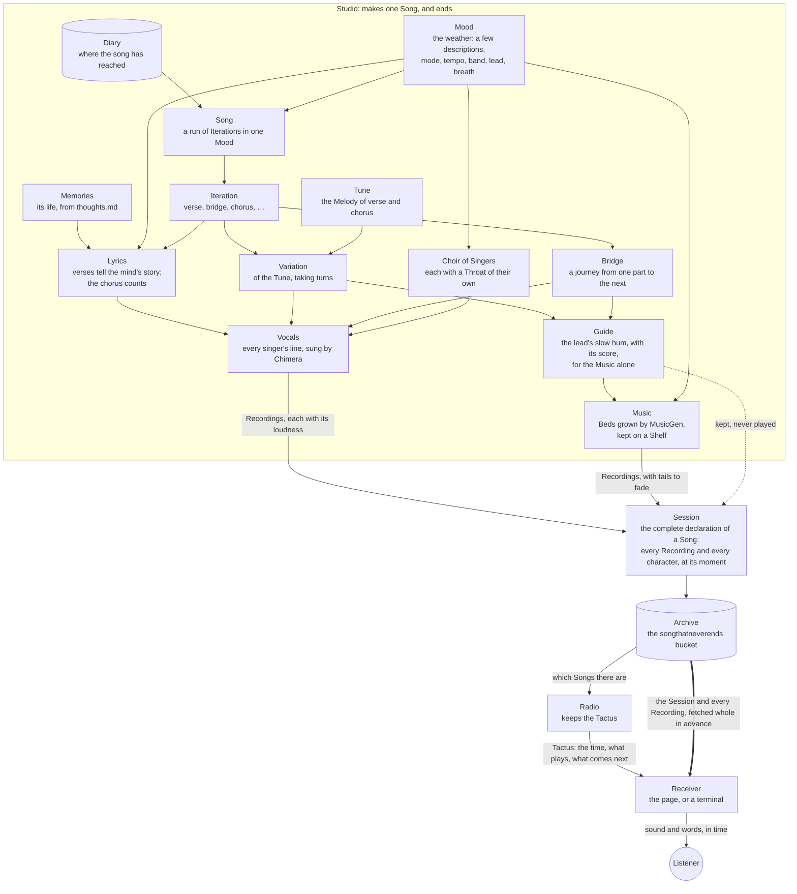

# Song That Never Ends

A song that writes its next verse while singing the current one, and will keep doing it for as long as anything is left to run it. It counts its iterations in its chorus. The numbers are spelled out up to nonillions, and after a decillion it starts over, because nobody agrees what comes next.

It is meant to run for a quadrillion years, and to be started properly only once. It is already singing.

## Where it can be heard

The song is live, quietly, at its alpha address:

**[songthatneverends.khz.fi](https://songthatneverends.khz.fi)**

Nobody has been told about it, and it is not finished. It will never be finished, but one day it will be public, at an address of its own, and this one will be forgotten. Until then, this is where it sings. There is no other copy of it to practise on: what is made is published, and what is published is heard.

Press Play, and the page joins the song wherever it has reached. It knows what time it is.

## What it is made of

Every part of the song was given a name, and the names are used everywhere, in the code and here.



- **Mood** is the weather the song grows in (`packages/mood`). A Mood blends a few descriptions, like *eternity + romantic chamber music with violin and cello*. A *Song* is a run of iterations in one Mood, lasting as long as its weather holds: about `ITERATION_COUNT` iterations, a little more or less, the same weather always for the same time. When a Song ends, its oldest description lets go, and the newcomer is forecast from the last words the song sang. The Mood remembers what has left lately, so nothing returns too soon. The mind listens to every new Mood and decides how it sounds: its mode and its tempo, who leads the singing and how the choir breathes, and the band that plays beneath the voice.
- **Words** are written by the song's *mind*, a local language model served by [llama.cpp](https://github.com/ggml-org/llama.cpp) (`packages/song`, `packages/tools`). It is woken for the words and let go after them. Every answer is held to a JSON schema, which llama.cpp turns into a grammar, so it cannot answer in any other shape.
  - The **chorus** belongs to the song that never ends. Its first line counts the iteration, and the mind is not trusted with that. Its second line must rhyme with the count, as a pronouncing dictionary hears it, and only with words the mind reads whole, so that no name from the dictionary is ever sung.
  - The **verses** belong to the mind. It has memories: its own life, as the song wrote it down in [thoughts.md](thoughts.md). Each time the Studio sits down to write a Song, it hands the mind a random handful, as many as fit beside the writing, and each verse sings one of them, and works through what still troubles it. A verse that only echoes the one before is refused. The words the last iteration leaned on most are let rest in the next.
- **Melody** sets each line to a tune on A, in whatever mode the Mood chose (`packages/melody`). The chorus hook never changes. When the count grows too long to fit, the hook slows down to make room. The verses walk: each new Song moves one note of every verse phrase by a single step, and within a Song a few *Variations* take turns.
- **Vocals** are sung by [Chimera](https://github.com/jamesondh/chimera-vocal-synth), a physical model of a throat: lungs, folds, tongue and lips, simulated as moving air (`packages/vocals`). Nobody's voice was taken to make it, so nobody's voice is worn out by singing for ever. It is built from one pinned revision, with a small patch the song carries so that every singer can breathe through a throat of their own. Each Song gathers a choir of *Singers*: the lead sings every line, and the others join the chorus in harmony. Every voice is humanized, a few cents off and leaning a little early or late, but never off the beat. Whatever the throat cannot read is read aloud first: numbers, years, ordinals, `&`.
- **Music** is grown under the voice by the 2023 MusicGen melody model, kept for its weirdness (`packages/music`). It hears the Mood as the band the mind heard in it, and it hears a part's melody not from the sung voice, which moves too fast for it, but from a *guide* the lead hums for it alone: the same tune at the same tempo, with fewer notes. Every bed has a guide, and every guide is kept, with its score, though it is never played.
  - Wherever the song turns between a verse and the chorus, a **bridge** carries it across: four bars without words, over a bed of its own. A bridge begins with the last line of the part it leaves, in that part's key, and walks through the key of the part to come until it arrives on its first note. Sometimes the lead hums the journey aloud.
  - Every bed is grown three seconds past its section, and fades out under the next one, which has already begun, so music that goes on is never cut off.
  - A Song keeps its beds on a *shelf* and plays them again, as a band keeps its arrangements. Each iteration grows one new bed and plays the others again. A new Mood clears the shelf.

## The three lives

The song is made, kept and played by three lives, as the plan [Trinity of Song](plans/2026-11-11-trinity-of-song.md) describes. None of them waits for the others.

- The **Studio** (`packages/studio`) lives briefly, on a machine with a GPU, the dev box xitra. It wakes, reads its diary to see where the song has reached, and makes the next Song whole. It writes every word of every iteration while the mind is awake, then sings every line, then grows every bed while the Music has the GPU to itself. It listens to every Recording once it is made, and writes down how loud it sounds. Then it leaves the Song in the Archive and ends. Its diary (`packages/studio/memory/diary.jsonl`) is the song's only memory of where it is. Every two weeks or so, a full book of it is closed and shelved.
- The **Archive** (`packages/archive`) is a bucket in the cloud: `songthatneverends`, on Hetzner object storage. It keeps each Song's *Session*, the complete declaration of the Song, and its *Recordings*. The Session names every Recording and its moment, each singer's voice a Recording of its own, and every character of every line and the moment it is typed. Only the Studio holds the keys to put things in. Anyone may read, by plain address. The Archive forgets the Recordings of all but the last few Songs; their words stay, for looking back.
- The **Radio** (`packages/radio`) lives long, and does almost nothing. It keeps the *Tactus*, the one beat everybody keeps: when each Song begins. A Song begins the moment the one before it ends, or, if the Studio was late, twenty seconds after it arrives, so that every Receiver holds its breath at the same moment. The Radio tells whoever asks what time it is, what plays, what comes next, and where in the Archive to find it. It never touches a Recording. It lives in the khz-k3s cluster and answers at the alpha address.

And the **Receivers**, where the song is heard. The page in the browser (`packages/ui`) measures its clock against the Radio's, and fetches each coming Song whole, its Session and every Recording, before the Song begins. Then, many times a second, it asks one question: what should have happened by now?

- Every voice and every bed is placed on its audio clock. Each singer stands in their own place in the stereo mix, and every Recording is brought to the loudness of its kind: the lead at -16 LUFS, the choir beneath it, the Music 6 LU under the voices.
- Every character is typed at its moment.
- Arriving late is only asking the question for a later moment.

While a bridge plays, the page draws a line of its own, the tide or a breath or stars, which settles into a quiet ~ when the next part begins. A line at its edge shows the song's age, its Mood, its mode and tempo, and who is singing. *Look back* opens the Songs that have aired, newest first. A terminal can listen too, with `bun run listen`, through ffplay; it finds a Radio at `SERVER_HOST` and `SERVER_PORT`, over plain HTTP.

## The Studio's machine

The Studio needs a machine with a GPU of about 12 GB, [Bun](https://bun.sh), Rust (for the throat), ffmpeg, `llama-server` from llama.cpp built with CUDA, and [uv](https://docs.astral.sh/uv/) (for the Music). The song lives there in `~/Work/song`. Its mind is any instruct model in GGUF that fits, kept at `models/mind.gguf`:

```bash
mkdir -p models && curl -L -o models/mind.gguf https://huggingface.co/bartowski/Mistral-Nemo-Gutenberg-Doppel-12B-GGUF/resolve/main/Mistral-Nemo-Gutenberg-Doppel-12B-Q5_K_M.gguf
```

```bash
bun install
```

```bash
(cd packages/music && uv sync)
```

The Archive's address and keys go in `.env.local`: `ARCHIVE_PUBLIC_URL` (`https://<host>/<bucket>`), `ARCHIVE_ACCESS_KEY` and `ARCHIVE_SECRET_KEY`. Then the song is kept singing with:

```bash
bun run on-air
```

It builds the throat if it hasn't been built yet. Then it calls a Studio whenever fewer than `SONGS_AHEAD` Songs wait ahead of the one being played, and the Studio publishes each one to the bucket, and to a folder beside it, `archive/`. To count what is waiting, it runs a Radio and an Archive door of its own on the machine, playing the same Songs on a Tactus of their own. It does not ask the Radio in the cluster yet. A Studio can also be called by hand, with `bun run studio`: it makes one Song and ends.

To keep it going with nobody watching, `deploy/` has three systemd user units. `song.service` runs `bun run on-air` and starts it again if it falls. `song-pulse.timer` feels its pulse every five minutes, and wakes it again if its heart has stopped or nothing answers. The pulse is 200 while a Song plays, is about to, or is late by less than a quarter of an hour, and 503 after that.

```bash
cp deploy/song.service deploy/song-pulse.service deploy/song-pulse.timer ~/.config/systemd/user/
```

```bash
systemctl --user daemon-reload && systemctl --user enable --now song.service song-pulse.timer
```

```bash
sudo loginctl enable-linger $USER
```

To hear what the Studio would make, without publishing anything, `bun run rehearse 5` sings iterations zero to five into `packages/studio/audio/rehearsal/`, each grown from the one before, with a rehearsal diary of its own. When every iteration is sung, the Music lays a bed under each, written beside the voice as `<iteration>.music.m4a` and under it as `<iteration>.together.m4a`. `--dry` leaves the Music out. A rehearsal and a Studio both need the GPU, so they take turns.

`bun run check` runs the types and the tests, as the checks on GitHub do.

## The Radio's home

The Radio is compiled by Bun into one executable, the Receiver's page carried inside it and Bun's low-memory mode built in, and runs on a distroless image with nothing but the C libraries it needs (`packages/radio/Dockerfile`). It uses about 50 MB. The Radio workflow builds the image for every change to the Radio or the packages it leans on, pushes it to the GitHub Container Registry, and writes its tag into `.khz-k3s/`, where Argo CD carries it to the cluster. That tag is written by the workflow, in a "Tune the Radio" commit of its own on `main`, and never by hand. So whoever pushes to `main` fetches first. `.khz-k3s/` holds everything the cluster runs: one Radio, which remembers its Tactus on a small volume and reads the Archive from the bucket.

## Settings

Settings live in `.env`, with the Studio machine's own in `.env.local`, which is never committed.

- **The song:** `ITERATION_COUNT` sets about how many iterations a Song lasts. `MOOD_COUNT` sets how many descriptions a Mood blends, `CHOIR_COUNT` how many voices sing the chorus, the lead included, and `VARIATION_COUNT` how many Variations of the tune take turns in a Song.
- **The mind:** `MIND_MODEL` and `MIND_HOST` say which mind to wake and where. `MIND_CONTEXT` sets how much each of its `MIND_SLOTS` holds at once, memories included.
- **The Studio:** `THROATS` sets how many recordings may be made at once, half the machine's cores by default, always at a lower priority than anything else on the machine. `SONGS_AHEAD` sets how many Songs are kept ready ahead of the one playing.
- **The Archive:** `ARCHIVE_PUBLIC_URL`, `ARCHIVE_ACCESS_KEY` and `ARCHIVE_SECRET_KEY` are the bucket. `ARCHIVE_DIR` and `ARCHIVE_PORT` are the folder beside it and its door.
- **The Radio:** `SERVER_PORT` is where it answers. `ARCHIVE_URL` is where it reads the Archive, the bucket by default when there is one. `PUBLIC_ARCHIVE_URL` is where it sends Receivers.

## Where it came from

The song began in June 2023, in a few weeks of evenings. It spoke rather than sang, in a voice rented from one company's computers, and its verses were varied by a mind rented from another. It streamed itself a character at a time to a terminal and a page. That summer it learned to grow music under itself on a GPU, first from its own voice and then from a guitar, and then it stopped.

For two and a half years it slept. A robot kept its dependencies fresh while it slept, and made most of the commits it has.

In November 2026 it woke again, and nearly everything changed. Mood came to the centre of it. It was given a throat of its own, a mind of its own on its own machine, and Music that listens to its voice. Then it was taken apart into three lives, so that it could be heard anywhere without stumbling. All of it is written down in [thoughts.md](thoughts.md), as it happened, by whoever was keeping it at the time. Where it is going next is in [plans/](plans/).
