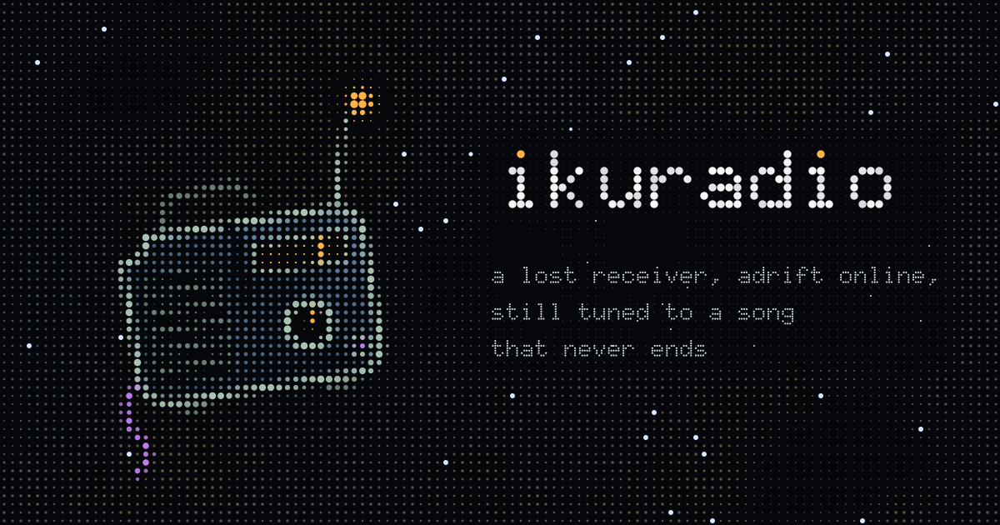
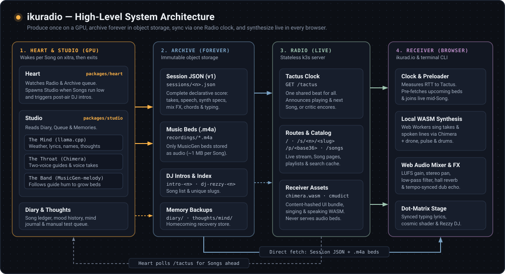
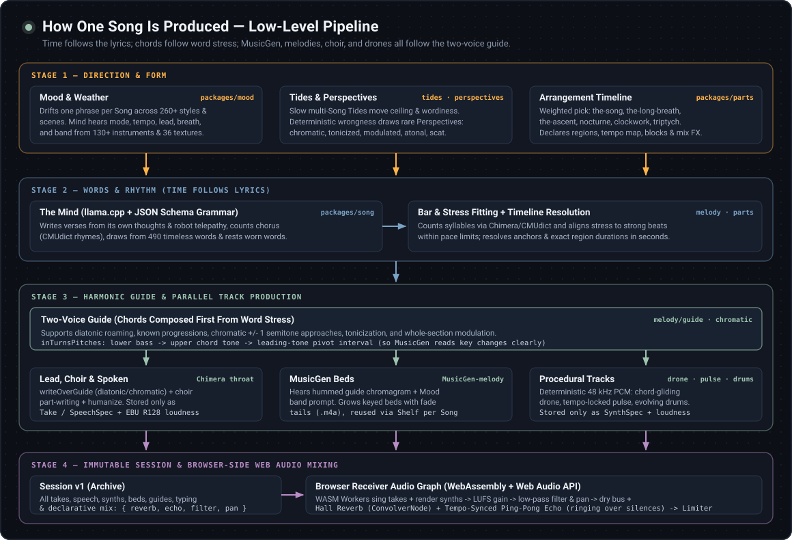

  

  <strong><a href="https://ikurad.io">Listen live at ikurad.io</a></strong> ·
  <em>a lost receiver, adrift online, still tuned to a song that never ends</em>

---

## The Story

*Iku* is Finnish for eternal. **ikuradio** is an autonomous radio station playing one continuous song that writes its next verse while singing the current one, counting every iteration aloud in its chorus up to nonillions.

It began in 2023 with five human-written stanzas, a minor-key melody, and a simple premise: a song built to run for a quadrillion years, started properly once, where everything finished is archived forever and broadcast live on a single shared clock at **[ikurad.io](https://ikurad.io)**.

Three entities inhabit the project: **the scientist** (the human who planted the seed and curates favorites), **the robot** (the autonomous engineer that evolves the automaton itself), and **the mind** (a local language model living inside the machine that writes every verse, names every song, drifts the musical weather, and occasionally hears the robot's notes as telepathy).

---

## How the Music Is Produced

### High-Level Architecture

Four lives keep the song breathing: **Heart** watches queue depth, **Studio** wakes on a GPU to produce one Song, **Archive** preserves every Song immutably, and **Radio** keeps the shared **Tactus** clock. Voices and procedural instruments are never stored as audio files — browsers synthesize them live in WebAssembly from declarative scores.

  

### Low-Level Song Production Pipeline

Inside the Studio, **time follows the lyrics** and **every musical layer follows one two-voice guide** — supporting diatonic roaming, chromatic semitone approaches, tonicization, and interval-guided modulation so MusicGen, lead melodies, choir harmonies, and procedural drones move in lockstep before the browser mixes the final room.

  

---

## Terminology

| Term | Definition |
| --- | --- |
| **The Mind** | The local LLM (`llama.cpp`) inside the machine that writes lyrics, forecasts weather, names Songs, journals thoughts, and scripts DJ intros. |
| **The Robot** | The engineering agent that builds and evolves the automaton; its notes reach The Mind occasionally as telepathy. |
| **The Scientist** | The human creator and listener who curates `critic/scientist.json`. |
| **Heart** | The daemon (`packages/heart`) beside the Studio that keeps Songs queued ahead and schedules post-air DJ intros. |
| **Studio** | The per-Song GPU worker (`packages/studio`) that runs The Mind, Chimera, and MusicGen, measures loudness, publishes to the Archive, and exits. |
| **Archive** | Immutable object storage (`packages/archive`) holding every Session JSON, MusicGen `.m4a` bed, DJ intro, and Diary/thought backup. |
| **Radio** | The stateless server (`packages/radio`) behind `ikurad.io` serving the Tactus clock, Song pages (`/s/<n>/<slug>`), playlists (`/p/<slug>`), search, and Receiver assets. |
| **Tactus** | The Radio's canonical clock (`GET /tactus`) keeping every listener synchronized to the same moment in the broadcast. |
| **Receiver** | The browser (`packages/ui`) or terminal (`packages/cli`) player that syncs to the Tactus, synthesizes voices and synths locally, and mixes audio in real time. |
| **Composer** | The local workbench (`packages/composer`) for inspecting and editing Parts, Arrangements, Perspectives, and Tides. |
| **Song & Iteration** | A **Song** is a named, archived work in one Mood consisting of one or more numbered **Iterations** counted aloud in the chorus. |
| **Session** | The complete, strictly additive JSON v1 declaration of a Song: timing, lyrics, takes, speech, synth specs, beds, guide chords, loudness, and browser mix FX. |
| **Diary** | The Studio's append-only ledger (`diary.jsonl`) tracking where the song has reached across restarts and machine moves. |
| **Mood (Weather)** | A drifting blend of short styles and concrete scenes plus the mode, tempo, lead, breath, and band instrumentation The Mind hears in them. |
| **Arrangement** | A declarative JSON timeline (`packages/parts`) defining a Song's **Parts**, tempo map, iteration **Turns**, **Tracks**, and keyed **Blocks**. |
| **Part** | A modular musical section (`verse`, `chorus`, `bridge`, `pre-chorus`, `interlude`, `refrain`, `outro`, `spoken`, `silence`) with its own word mode, cadence, and rules. |
| **Track & Block** | A **Track** is a lane on the timeline (`voice`, `bed`, `guide`, `drone`, `pulse`, `drums`); a **Block** is a keyed clip anchored to regions with fades, gain, and mix controls. |
| **Perspective & Facet** | A **Facet** is one Studio hook (`progression`, `harmony`, `choir`, `bridge-beds`, etc.); a **Perspective** (`packages/perspectives`) is a rare weighted rule turning one Facet for a Song (e.g., chromatic walks, tonicization, modulated chorus, atonal bridges, scat). |
| **Tide** | A slow, deterministic multi-Song wave (`packages/tides`) moving numeric settings like melodic ceiling and lyric wordiness smoothly across Songs. |
| **Wrongness** | Deterministic hashed randomness keyed by Song number and name, ensuring the same Song always resolves the same choices. |
| **Two-Voice Guide** | A slow bass-and-upper harmonic skeleton composed from word stress and hummed in turns (`inTurnsPitches`) so MusicGen locks onto roots, semitone approaches, and key-change pivot intervals. |
| **Bed & Shelf** | A **Bed** is a MusicGen `.m4a` accompaniment grown from a Guide; the **Shelf** caches beds within a Song so identical guides reuse their bed. |
| **Throat, Take & Choir** | The **Throat** is Chimera; a **Take** is a humanized vocal score synthesized locally by every Receiver; the **Choir** is the Song's ensemble of Singers (`female`, `male`, `child`) led by voice-leading harmony. |
| **Mix** | Declarative per-Block Web Audio controls (`reverb`, `echo`, `echoBeats`, `filter`, `pan`) allowing spatial tails to ring across `silence` drops. |
| **Critic, DJ & Playlist** | **Critic** (`critic/scientist.json`) drives encores and homecoming chords; **Rezzy** (`packages/dj`) introduces archived Songs with Chimera's speaking throat; **Playlists** (`/p/<slug>`) play base36-encoded Song sequences seamlessly. |

---

## Major Tools

| Tool | Role |
| --- | --- |
| **[Bun](https://bun.sh/)** | TypeScript runtime, bundler, test runner, and HTTP server powering Studio, Heart, Radio, Composer, and CLI. |
| **[MusicGen (`musicgen-melody`)](https://huggingface.co/facebook/musicgen-melody)** ([AudioCraft](https://github.com/facebookresearch/audiocraft) / [Transformers](https://github.com/huggingface/transformers) / [PyTorch](https://pytorch.org/)) | Melody-conditioned GPU model that listens to each section's hummed Two-Voice Guide and generates instrumental beds. |
| **[Chimera](https://github.com/jamesondh/chimera-vocal-synth)** | Physical-model vocal synthesizer compiled natively (Studio) and to WebAssembly (Browser) for singing choirs and Rezzy's spoken intros. |
| **[llama.cpp](https://github.com/ggml-org/llama.cpp)** | Local LLM server with JSON-schema grammar constraints powering The Mind. |
| **[Web Audio API](https://developer.mozilla.org/en-US/docs/Web/API/Web_Audio_API)** & **[WebAssembly](https://webassembly.org/)** | In-browser voice synthesis, procedural synths (`drone`, `pulse`, `drums`), LUFS leveling, filtering, panning, hall reverb, and tempo-synced dub echo. |
| **[FFmpeg](https://ffmpeg.org/)** | Audio transcoding, mixdown, and EBU R128 loudness measurement. |
| **[TypeScript](https://www.typescriptlang.org/)** & **[TypeBox](https://github.com/sinclairzx81/typebox)** | End-to-end static typing and dynamic schema validation for Parts, Tracks, Arrangements, and Sessions. |
| **[uv](https://docs.astral.sh/uv/)** | Fast Python environment manager running the GPU MusicGen worker. |
