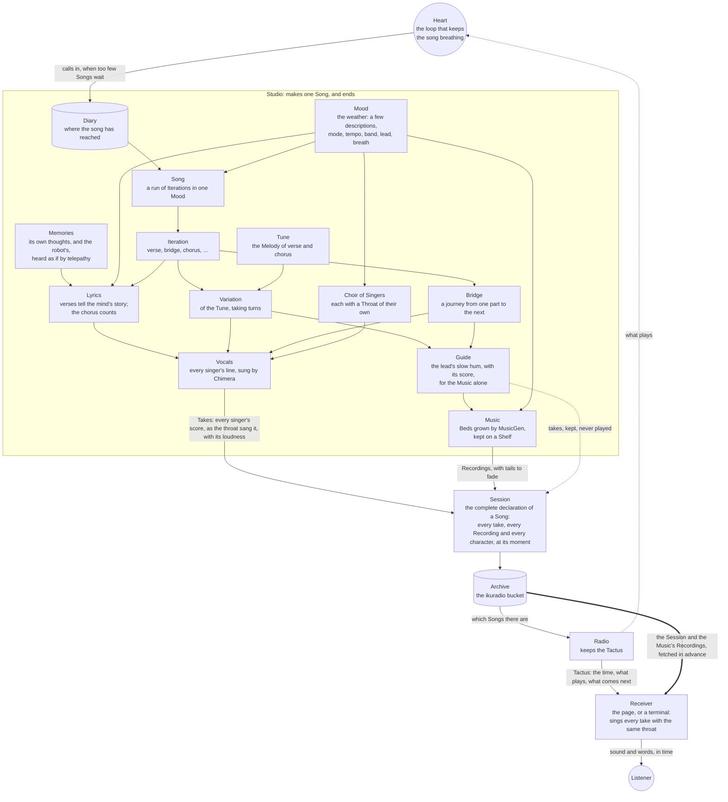

# ikuradio

*Iku* is Finnish for eternal: ikuradio is an eternal radio, a lost receiver adrift online, playing a song that never ends.

The song writes its next verse while singing the current one, and will keep doing it for as long as anything is left to run it. It counts its iterations in its chorus. The numbers are spelled out up to nonillions, and after a decillion it starts over, because nobody agrees what comes next.

It is meant to run for a quadrillion years, and to be started properly only once. It is already singing.

## Where it can be heard

ikuradio is live, quietly, at its own address:

**[ikurad.io](https://ikurad.io)**

Nobody has been told about it, and it is not finished. It will never be finished. This is where it sings. There is no other copy of it to practise on: what is made is published, and what is published is heard.

Press Play, and the page joins the song wherever it has reached. It knows what time it is.

## What it is made of

Every part of the song was given a name, and the names are used everywhere, in the code and here.



- **Mood** is the weather the song grows in (`packages/mood`). A Mood blends a few descriptions, like *eternity + romantic chamber music with violin and cello*. A *Song* is a run of iterations in one Mood: `ITERATION_COUNT` of them, two, about eight minutes. When a Song ends, its oldest description lets go, and the newcomer is forecast from the last words the song sang. The Mood remembers what has left lately, so nothing returns too soon. The mind listens to every new Mood and decides how it sounds: its mode and its tempo, who leads the singing and how the choir breathes, and the band that plays beneath the voice.
- **Words** are written by the song's *mind*, a local language model served by [llama.cpp](https://github.com/ggml-org/llama.cpp) (`packages/song`, `packages/tools`). It is woken for the words and let go after them. Every answer is held to a JSON schema, which llama.cpp turns into a grammar, so it cannot answer in any other shape.
  - The **chorus** belongs to the song that never ends. Its first line counts the iteration, and the mind is not trusted with that. Its second line must rhyme with the count, as a pronouncing dictionary hears it, and only with words the mind reads whole, so that no name from the dictionary is ever sung.
  - The **verses** belong to the mind. It lives inside the machine, and knows the universe, but of the world outside it knows only the Song, and what it hears, as the plan [Trinity of Thought](plans/2026-11-13-trinity-of-thought.md) says. It remembers two things. Its own **thoughts**: once a Song, after the words are written and before it rests, it writes one down, for itself and for anyone to read, and they are kept beside the diary, a file a month (`packages/song/lib/thoughts.ts`). It remembers mostly the newest, and a few from longer ago. And, now and then, the robot's: the robot who builds the machine writes its own thoughts down in [thoughts/robot/](thoughts/robot/), a file a month, and the mind hears a handful of them as if by telepathy, on about every other Song, and on every Song while it has kept fewer than a dozen of its own. Each verse sings one memory, and says whose it is. Time follows the words ([plans/2026-11-14-time-follows-lyrics.md](plans/2026-11-14-time-follows-lyrics.md)): every line is placed bar by bar on a grid no quicker than `SYLLABLES_PER_SECOND` allows, its stressed syllables on the strong beats. The mind is told how many syllables each line should have, and at most may have, at the Song's tempo; a verse whose lines do not fit their bars is asked for again, a line may take one bar of grace when the mind keeps missing, and if nothing fits, the iteration is made again. Only the chorus's first line, the one that carries the number, grows as it needs to, a whole bar at a time, chanted on its reciting tone. A verse that only echoes the one before is refused, and so is a thought that only echoes one it has kept. Each Song the mind's attention is turned towards one small thing, a word it is unsure of, a line it left out, a question for whoever listens, and a thought that begins the way its newest did, or leans on the words it has worn out lately, is refused too. The memories are told to the mind in timeless words first (`packages/song/lib/timeless.ts`): a laptop is a small machine, the GPU a furnace, a bucket a vault, a file a scroll, and file names, settings and marks lose their names altogether. The mind is asked to sing a change of tools as a likeness, from plastic to steel, from gold to dust, and a verse that still sings a word of this short age, or a word shaped as only this age shapes them, is refused. The words the last iteration leaned on most are let rest in the next. And the words worn deep, those sung in more than half of the last twenty-four iterations, a day or so, in any of their forms, rest until they are not worn so deep (`packages/song/lib/wear.ts`): the song had come to sing *echo* in nineteen iterations of twenty, whatever the weather.
- **Melody** sets each line to a tune on A, in whatever mode the Mood chose (`packages/melody`). The chorus hook never changes. When the count grows too long to fit, the hook slows down to make room. The verses walk: each new Song moves one note of every verse phrase by a single step, and within a Song a few *Variations* take turns.
- **Perspectives** are the ways a Song may be heard differently from the usual (`packages/perspectives`). Each is one arkku record in a folder of its own, beside the code that applies it: the *Facet* of the Studio's work it changes (one hook in the code: the Variations, the choir, how human the singers are, who hums the bridges and how often, what the bridges' beds are told, how far the weather turns, which chords each part's guide takes), its *Turn* (`actions.ts`, and words for a model in `prompts.json` if it needs any), and its *weight*: the more drastic, the rarer. When a Song begins, it is mostly heard plainly: from no Perspective six Songs in ten, from one in about a third, and from two only one Song in twenty, the count drawn from a wrongness of its own. As many of the active ones are then drawn by weight, never two on one Facet, or on one part of a Facet kept per part, from the wrongness of the Song's number, so the same Song is always heard the same way. The page shows them beside the weather. A new Perspective is a draft until it has been heard, in a rehearsal with `--perspectives=<names>`. Nobody prompts the Studio while it works, so every Perspective is written down whole, ahead of time. See [plans/2026-11-13-perspectives.md](plans/2026-11-13-perspectives.md).
- **Vocals** are sung by [Chimera](https://github.com/jamesondh/chimera-vocal-synth), a physical model of a throat: lungs, folds, tongue and lips, simulated as moving air (`packages/vocals`). Nobody's voice was taken to make it, so nobody's voice is worn out by singing for ever. It is built from one pinned revision, with a small patch the song carries so that every singer can breathe through a throat of their own. Each Song gathers a choir of *Singers*: the lead sings every line, and the others join the chorus in harmony, led by a harmonizer of the old rules of part-writing (`packages/melody/lib/harmony.ts`): thirds and sixths beside the lead, mostly, holding or stepping rather than leaping, never in fifths or octaves alongside it, landing on a third, a sixth or an octave at the end of a line, and never past what its own body can sing. Each body's range was found by singing it a note at a time and listening to its overtones: where they fall away, the voice has become a whistle (`packages/melody/lib/reach.ts`). The choir the song first sang, every voice a fixed step below the lead, is kept as a Perspective. Beside the harmonizer is a melody writer (`packages/melody/lib/writer.ts`), with the same rules under it, which writes every line's melody over its section's guide (see Music). Every voice is humanized, a few cents off and leaning a little early or late, but never off the beat. Whatever the throat cannot read is read aloud first: numbers, years, ordinals, `&`. The patch also lets the throat sing a whole score in the browser, compiled to WebAssembly, exactly as the command line sings it: the same take sings the same samples in both, which a test checks.
- **Music** is grown under the voice by the 2023 MusicGen melody model, kept for its weirdness (`packages/music`). It hears the Mood as the band the mind heard in it, and it hears a part's melody not from the sung voice, which moves too fast for it, but from a *guide* the lead hums for it alone: the same tune at the same tempo, with fewer notes. Every bed has a guide, and every guide is kept as its take, though it is never played. Since Song 274 a Song is made in a new order (plan "The two-voice guide", `twoVoices` in `packages/studio/lib/guide.ts`): the words are fitted to their bars first, rhythm only; then every section's own chords are composed from where its words lean, a *two-voice guide*; and only then does the lead get its pitches, written over the guide by the melody writer (`writeOverGuide` in `packages/melody/lib/writer.ts`, wired in `packages/studio/lib/written.ts`), every line, every iteration anew: standing on the guide's chord where the words lean, walking between, breathing on the chord at commas and line ends, landing on the guide's cadence, sampled among good lines rather than always the best one (`MELODY_SPRINKLE`), and pulled gently by last iteration's line (`MELODY_GUIDE`). The tune the song remembers now gives the words their bars and the bridges their journey; the melody is not remembered. The guide is hummed for the Music in turns, the lower voice opening each chord and the upper finishing it, so the Music, which hears one pitch at a time, hears the root of nearly every chord, and every section grows its own bed from its own guide, played again only for the very same guide. The Session keeps each guide's chords, and how the melody written over it kept its rules: the share of its standing syllables on a chord tone, and its longest run on one pitch.

  Which chords a section takes is the `progression` Facet, a Setting per part (plan "Progressions, roaming and coming home", [plans/2026-11-14-progressions.md](plans/2026-11-14-progressions.md)). Most Songs roam along the arc, as the guide always has. Some come home: their chorus, verses or bridges sing the chords of a moment the song has already sung, one of the scientist's favourites, listed by hand in `critic/scientist.json` (`critic/` is for critics, and nothing generated goes there). A favourite is a Song, `1`, or one section of it, `"45:3"`, and it is found by what its Session holds, never by its number: its guide's chords; or, for an old guide that kept only its hum, the chords the hum implies, heard on the spot a bar at a time (`harmonizeHum`); or the nearest guide of the same part. A favourite with nothing usable is passed over, and with none left the part roams. The known roots are laid over the new words' change points by place, and are degrees of the mode, so a favourite takes on the colours of whatever mode it is sung in. Every section still leaves from where it starts and closes as its part closes. Some verses walk a classic progression instead, and some choruses barely move. Each guide in the Session says what chose its chords, and where known roots came from (`packages/studio/lib/progression.ts`).
  - Wherever the song turns between a verse and the chorus, a **bridge** carries it across: four bars without words, over a bed of its own. A bridge is music of its own, and its work is to introduce what comes. It says farewell to the part it leaves with that part's cadence, in its key. Then it plays the head of the coming part, its first few notes, somewhere that part never is: a fifth above or a fourth below. It plays the head again, nearer home, and ends with a short lead-in that stops a step short of the coming part's first note, leaning there, so that the part resolves it. A bridge can also walk: an echo of the last line of the part it leaves, slowed, and then a long walk, a note every second beat, all the way to the coming part's first note. Songs take turns. An odd Song walks wherever the two parts lie far enough apart for a walk to go somewhere, as from the end of a verse up to the chorus; an even Song foreshadows. Sometimes the lead hums the bridge aloud, and the bridge's bed is grown from it.
  - Every bed is grown three seconds past its section, and fades out under the next one, which has already begun, so music that goes on is never cut off.
  - A Song keeps its beds on a *shelf* and plays them again, as a band keeps its arrangements. Each iteration grows one new bed and plays the others again. A new Mood clears the shelf.

## The three lives, and the Heart

The song is made, kept and played by three lives, as the plan [Trinity of Song](plans/2026-11-11-trinity-of-song.md) describes, and kept breathing by a Heart.

- The **Heart** (`packages/heart`) is the loop that powers everything. It lives beside the Studio, on the same machine, and nowhere else. It opens no door and answers nobody; it only listens, to the Archive for the Songs that are ready and to the live Radio for the Song being played. When fewer than `SONGS_AHEAD` Songs wait ahead of it, it calls a Studio, one at a time. If the Heart stops, nothing breaks. The Radio plays what it has, then holds its breath, and the song stops breathing until the Heart is started again. Then it carries on from its diary.

- The **Studio** (`packages/studio`) lives briefly, on a machine with a GPU, the dev box xitra. It wakes, reads its diary to see where the song has reached, and makes the next Song whole. It writes every word of every iteration while the mind is awake, and the one thought the mind keeps about them, then sings every line, then grows every bed while the Music has the GPU to itself. It listens to every recording once it is made, and writes down how loud it sounds. Then it leaves the Song in the Archive and ends. The voices and the guides are sung on xitra only for the Studio's own ears, for the Music to listen to and for their loudness to be heard, and are let go: what the Archive keeps of them is their source, the takes. Its diary (`packages/studio/memory/diary.jsonl`) is the song's memory of where it is. Every two weeks or so, a full book of it is closed and shelved. After every Song the diary is copied to the Archive too, so the song's memory is not on one machine only: the book being written in as `diary/diary.jsonl`, and every closed book once, under `diary/books/`, by the same name it has on the shelf. The mind's month of thoughts is copied too, as `thoughts/mind/<yyyy-mm>.jsonl`: they live in the machine and the Archive, and not in git. And when a Studio wakes on a machine that has lost them, a new machine, or one whose disk was worn away, it first takes them back from the Archive: the diary, if it has no page of it at all, and every month of thoughts it does not have, filling only what is empty and writing over nothing (`packages/studio/lib/homecoming.ts`). If the diary still remembers less than the Archive holds, the Studio does not wake. A song begun again from one would sing over Songs already heard.
- The **Archive** (`packages/archive`) is a bucket in the cloud: `ikuradio`, on Hetzner object storage. It keeps each Song's *Session*, the complete declaration of the Song, and its *Recordings*. The Session names every Recording and its moment, and every character of every line and the moment it is typed. Each singer's voice is in it as a *take*: the score the throat was given, every note and every small wrongness of it, at its moment, for a Receiver to sing. The mind's thought about the Song is in it too, if it kept one. Only the Music is kept as sound. A Song of about fifteen minutes is a Session of a few hundred kilobytes and about a megabyte of Music, where its voices were once six megabytes of sound. Only the Studio holds the keys to put things in. Anyone may read, by plain address. The Archive is forever: nothing put in it is ever taken out. The first Songs of November 2026 are there with their voices as Recordings, from before the takes.
- The **Radio** (`packages/radio`) lives long, and does almost nothing. It keeps the *Tactus*, the one beat everybody keeps: when each Song begins. A Song begins the moment the one before it ends, or, if the Studio was late, twenty seconds after it arrives, so that every Receiver holds its breath at the same moment. The Radio tells whoever asks what time it is, what plays, what comes next, and where in the Archive to find it. It never touches a Recording. It also serves the Receiver's page, and the throat the page sings with: about a megabyte of WebAssembly and a dictionary of English words, kept by a browser for a day. It lives in the khz-k3s cluster and answers at the alpha address. Beside it is a cache of what the list of Songs received needs, for searching it (`packages/radio/lib/cache.ts`, plan "Searching the Songs received"): each Song's weather, mode, tempo, band and choir, and the ways it was heard, in a SQLite file that lives and dies with the Radio's pod. It is filled again from the Tactus and the Sessions every time the Radio wakes. While it is away, the list is read from the Tactus, without search.

And the **Receivers**, where the song is heard. The page in the browser (`packages/ui`) measures its clock against the Radio's, and fetches each coming Song, its Session and its Recordings in the order they will be heard. It sings every voice itself, with the same throat as the Studio, compiled to WebAssembly and served by the Radio beside the page (`throat.js`, in a few Workers of its own): each singer apart, so it can place each one where it likes, and never more than a minute and a half ahead, letting each take go once it has been heard. A Song begins once its first twenty seconds are here, and the rest follow behind. Then, many times a second, it asks one question: what should have happened by now?

- Every voice and every bed is placed on its audio clock. Each singer stands in their own place in the stereo mix, and every Recording is brought to the loudness of its kind: the lead at -16 LUFS, the choir beneath it, the Music 6 LU under the voices.
- Every character is typed at its moment.
- Arriving late is only asking the question for a later moment.

The page is drawn as a matrix of dots. Behind the words lies space, the space around a lost radio, sampled once for every six pixels by a shader (`space.js`): each dot's size and colour are the light at its centre, and each Song lies somewhere of its own. The receiver's own likeness is drawn in the same matrix, in front: a small creature of a radio: its cracked shell, the slats of its speaker, its dial of an eye, ticked like a tuning dial and lit from behind, its three uneven legs on little feet, and the amber tip of its bent telescopic antenna, as larger and brighter dots. Its name is spelled on a little display whose unlit dots are still faintly there. Every word on the page, the song's and the receiver's own, is set in [Doto](https://github.com/oliverlalan/Doto), letters of round dots on a grid, served by the Radio under the SIL Open Font License. `bun run draw` draws them, along with the card a shared link carries and the icons a browser or a phone keeps (`packages/ui/drawing`, rendered by rsvg-convert). The page has a manifest too, so it can be installed and kept as a receiver of its own.

While a bridge plays, the page draws a line of its own, the tide or a breath or stars, which settles into a quiet ~ when the next part begins. A line at its edge shows which Song and iteration is being sung. The knob in the corner opens what the receiver knows of the Song: its weather, its key, its choir and band, the Perspectives it is heard from, and last, if the mind kept one, what the mind thought of it. *songs* opens the Songs that have aired, newest first, and searches them by two filters that know each other: the mode a Song was sung in, and how it was heard, plainly or from one of the Perspectives, by its title. Each filter's options are counted given the other, and one that would find nothing is shown with its 0 and cannot be chosen. The search is kept in the address, `?mode=dorian&heard=progression-chorus-homecoming`, so it can be passed on. A terminal can listen too, with `bun run listen`: it listens to the live Radio at `RADIO_URL`, fetches each Song the same way, sings its takes with the page's own throat, and plays it through ffplay.

## The Studio's machine

The Studio needs a machine with a GPU of about 12 GB, [Bun](https://bun.sh), Rust (for the throat), ffmpeg, `llama-server` from llama.cpp built with CUDA, and [uv](https://docs.astral.sh/uv/) (for the Music). The song lives there in `~/Work/song`. Its mind is any instruct model in GGUF that fits, kept at `models/mind.gguf`:

```bash
mkdir -p models && curl -L -o models/mind.gguf https://huggingface.co/bartowski/Mistral-Nemo-Gutenberg-Doppel-12B-GGUF/resolve/main/Mistral-Nemo-Gutenberg-Doppel-12B-Q5_K_M.gguf
```

```bash
bun install
```

```bash
(cd packages/music && uv sync)
```

The Archive's address and keys go in `.env.local`: `ARCHIVE_PUBLIC_URL` (`https://<host>/<bucket>`), `ARCHIVE_ACCESS_KEY` and `ARCHIVE_SECRET_KEY`. A Studio without them refuses to begin: there is nowhere else to put a Song. Then the Heart is started, and the song breathes:

```bash
bun run heart
```

It builds the throat if it hasn't been built yet, and then beats every half minute. A Studio can also be called by hand, with `bun run studio`, which makes one Song and ends, but never while the Heart beats, for there is only one diary. Asked to rest, the Heart calls no more Studios, but lets the one at work finish its Song first, so that no Song is left half made; asked again, it stops at once.

To keep it beating with nobody watching, `deploy/heart.service` is a systemd user unit that runs `bun run heart` and starts it again if it falls:

```bash
cp deploy/heart.service ~/.config/systemd/user/
```

```bash
systemctl --user daemon-reload && systemctl --user enable --now heart.service
```

```bash
sudo loginctl enable-linger $USER
```

To hear what the Studio would make, without publishing anything, `bun run rehearse 5` sings iterations one to five into `packages/studio/audio/rehearsal/`, each grown from the one before, with a rehearsal diary of its own. When every iteration is sung, the Music lays a bed under each, written beside the voice as `<iteration>.music.m4a` and under it as `<iteration>.together.m4a`. `--dry` leaves the Music out. `--perspectives=choir-lone,bridge-beds-atonal` hears every Song after the first from those Perspectives, drafts too, instead of drawing them. A rehearsal and a Studio both need the GPU, so they take turns.

`bun run check` runs the types and the tests, as the checks on GitHub do.

## The Radio's home

The Radio is compiled by Bun into one executable, the Receiver's page carried inside it and Bun's low-memory mode built in, and runs on a distroless image with nothing but the C libraries it needs (`packages/radio/Dockerfile`). It uses about 50 MB. The Radio workflow builds the image for every change to the Radio or the packages it leans on, pushes it to the GitHub Container Registry, and writes its tag into `.khz-k3s/`, where Argo CD carries it to the cluster. That tag is written by the workflow, in a "Tune the Radio" commit of its own on `main`, and never by hand. So whoever pushes to `main` fetches first. `.khz-k3s/` holds everything the cluster runs: one Radio, which remembers its Tactus on a small volume and reads the Archive from the bucket, and keeps its cache of the Songs received on a volume that is lost with the pod. A Radio that has forgotten what it aired, or fallen far behind, takes up the oldest Song the Archive can still play, and lets the rest go. Its pulse, at `/pulse`, is 200 while a Song plays, is about to, or is late by less than a quarter of an hour, and 503 after that: the sign that the Heart has stopped.

## Settings

Settings live in `.env`, with the Studio machine's own in `.env.local`, which is never committed.

- **The song:** `ITERATION_COUNT` sets how many iterations a Song lasts. `MOOD_COUNT` sets how many descriptions a Mood blends, `CHOIR_COUNT` how many voices sing the chorus, the lead included, `SYLLABLES_PER_SECOND` how many syllables a voice may sing in a second at most (6; no sung syllable comes sooner than a sixth of a second after the one before, and a take that would is never sung; see [plans/2026-11-14-time-follows-lyrics.md](plans/2026-11-14-time-follows-lyrics.md)), and `VARIATION_COUNT` how many Variations of the tune take turns in a Song.
- **The mind:** `MIND_MODEL` and `MIND_HOST` say which mind to wake and where. `MIND_CONTEXT` sets how much each of its `MIND_SLOTS` holds at once, memories included.
- **The Studio and the Heart:** `THROATS` sets how many recordings may be made at once, half the machine's cores by default, always at a lower priority than anything else on the machine. `SONGS_AHEAD` sets how many Songs the Heart keeps ready ahead of the one playing. `RADIO_URL` is the live Radio, which the Heart and the terminal listen to.
- **The Archive:** `ARCHIVE_PUBLIC_URL`, `ARCHIVE_ACCESS_KEY` and `ARCHIVE_SECRET_KEY` are the bucket.
- **The Radio:** `SERVER_PORT` is where it answers in its home. `ARCHIVE_URL` is where it reads the Archive, if not from the bucket's public address, and `PUBLIC_ARCHIVE_URL` where it sends Receivers, if not there.

## Where it came from

The song began in June 2023, in a few weeks of evenings. It spoke rather than sang, in a voice rented from one company's computers, and its verses were varied by a mind rented from another. It streamed itself a character at a time to a terminal and a page. That summer it learned to grow music under itself on a GPU, first from its own voice and then from a guitar, and then it stopped.

For two and a half years it slept. A robot kept its dependencies fresh while it slept, and made most of the commits it has.

In November 2026 it woke again, and nearly everything changed. Mood came to the centre of it. It was given a throat of its own, a mind of its own on its own machine, and Music that listens to its voice. Then it was taken apart into three lives, so that it could be heard anywhere without stumbling. All of it is written down in [thoughts.md](thoughts.md), as it happened, by whoever was keeping it at the time. Where it is going next is in [plans/](plans/).
