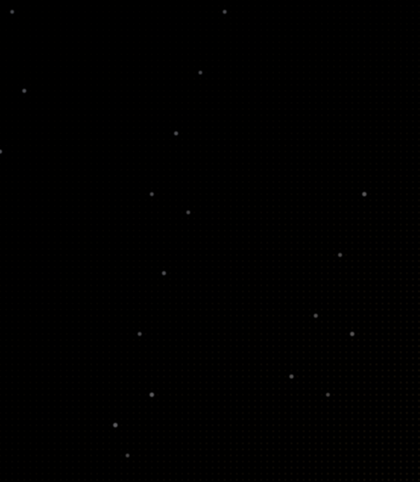

# The stars stand in lines

The far stars behind the Receiver's page fall on straight diagonal lines, as if strung on threads, not scattered the way stars are in a real sky. The scientist saw it on the page and asked for them to be more realistic.

**Where it comes from, most likely.** In `packages/ui/public/space.js`, a cell of the matrix holds a star when `hash(cell + shelf)` is above 0.9965. `hash` is the classic `fract(sin(dot(p, vec2(127.1, 311.7))) * 43758.5453)`. On whole-number cells that hash isn't random enough: cells along a direction where `dot(p, …)` steps by nearly a multiple of 2π get nearly the same value. Taking only the top 0.35 % of the values picks out exactly those runs, so the stars line up. (The time `waver` uses the same hash, but only the stars' places show it.)

**What "realistic" asks for:**
- **Places:** no lines and no grid feel. Clusters and voids, as a real sky has, and a few bright stars among many faint ones.
- **The hash:** a better integer hash for which cells hold a star, e.g. a PCG- or xxhash-style integer hash, or a two-step hash. The stars are still fixed to cells, and a Song's sky is still the same every time it is seen (`u_seed`).
- **Brightness:** varied, falling off as real magnitudes do (many faint, few bright), not all at 0.7. A faint touch of colour (bluish to warm) only if it stays within the page's palette.
- **Still a dot matrix:** a star is still one cell's dot. Nothing moves except the wavering they have now.

**Done when:**
- captures of every scene (`?scene=<name>&time=0`) at a few seeds show no lines;
- a test or a check looks at the star cells of a large field (e.g. 400×400 cells) and finds no direction with far more pairs than chance;
- the scientist looks at it on ikurad.io.
