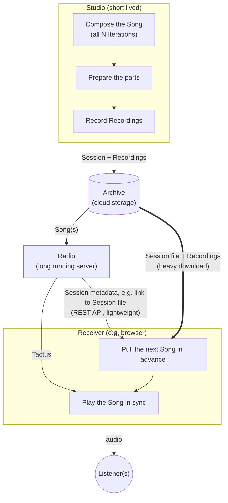

# Trinity of Song

Instead of nameless streaming-server-client setup, there will be three counterparties:

1. Studio composes the Song (all its N Iterations), prepares all the parts of the Song, records Recordings, stores the Session and Recordings for retrieval in Archive
2. Radio retrieves the Song(s) from Archive and distributes them to anyone who is interested via REST API. It also provides a time sync for Receivers to ensure they are playing the Song(s) in sync.
3. Receiver connects to Radio, pulls the Song(s), in advance, ensuring that the next Song is always fully prepared before the previous ends, so that the downloads don't disrupt the music.

Song has been declared in earlier plans. New Terms here are

- Studio: A short lived program, which executes a process that prepares and outputs a Session
- Session: The complete declaration of a Song, which contains
  - the metadata for playing the Song
  - links to the Recordings that are arranged to make the Song audible
- Recording: Any part of the music, which is produced in the Studio and played out as direct audio in the Receiver
- Archive: A cloud storage, storing the Recordings and Session, to allow the Song to be played to Listener(s).
- Radio: A long running server program, which serves Receivers. Helping them get the Sessions and Tactus, to be able to play the Song.
- Tactus: A shared understanding of time which all Receivers and Listeners need to follow, to play the Song in sync.
- Receiver: A client program, which connects to Radio and operates the Sessions, to play the Songs to the Listeners
- Listener: The end user, running the Receiver program (e.g. in their browser)

Receiver gets only the metadata for Session and Recordings from Radio. Technical details are intentionally left to be decided, but it could be simply a link to the Session file in Archive (e.g. Hetzner S3). Session contains identifiers for downloading the Recordings from the Archive as well. This keeps Radio-Receiver communication lightweight and each browser can download the heavy stuff from cloud storage.

