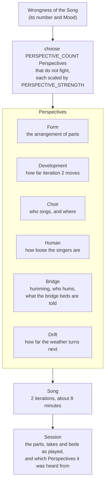

# Perspectives

A Song lasted 3–6 iterations, decided by the wrongness of its Mood: 9 to 28 minutes, 16 on average. Within a quadrillion years that is nothing, but for a contemporary human it is a long time to stay on a website, or even to listen to one piece of music.

So a Song is locked to **two iterations**: about 8 minutes at 72 bpm, from about 5.5 at the fastest tempos to about 9.5 at the slowest. That is long, but a reasonable default for a "progressive music" song. A Song change is an interesting but smallish change (the Mood drifts, a new choir is gathered, the verse tune takes a step), so the song still doesn't progress too fast, even though it now changes twice as often.

The wrongness that used to decide a Song's length is applied elsewhere instead, as **Perspectives**.

## Terms

- **Perspective:** one way a Song is heard differently from the usual. The wrongness of the Song chooses a few Perspectives for it, and how far each one goes. A Perspective holds for the whole Song: both of its iterations.
- **Wrongness:** as before, not random. The same Song (its number and Mood) always gets the same Perspectives, so it can be made again from the diary.

## Moderation

The changes stay moderate. Every Song is mostly the song as it usually is, with a few things heard from another side.

- `PERSPECTIVE_COUNT`: how many Perspectives a Song gets. Default 2. Never all of them at once.
- `PERSPECTIVE_STRENGTH`: how far a Perspective may go, from 0 (nothing changes) to 1 (the most the Perspective allows). Default 0.5. Each Perspective scales its own change by this, so the whole song can be made calmer or wilder from one place.
- A Song may have no Perspectives at all, now and then, and be heard plainly.
- Two Perspectives that would fight each other (for example "more humming" and "less humming") are never chosen together.

Iterations are no longer set by `ITERATION_COUNT` with a drift. A Song has two, fixed. Variations keep alternating: the first iteration sings the Song's tune, the second its Variation.

## The Perspectives

### Form

The arrangement of the iteration changes, instead of always verse · bridge · chorus · bridge · verse · bridge · chorus · bridge · verse · verse. For example:

- a long wordless bridge, where the Music stretches out
- the chorus doubled at the end
- an instrumental intro or outro over a bed
- a verse sung alone, without the Music

The Song's length moves by about a minute at most, through its shape rather than its duration.

### Development

How far the second iteration moves from the first. Today the Variation ornaments one verse phrase by one step. Under this Perspective it may go further: more phrases, more steps, or a key change up a step for the second iteration. Some Songs barely move; others turn somewhere new.

### Choir

Who sings, beyond the usual lead with two singers joining the chorus:

- a lone singer, with no choir at all
- a fuller choir, up to four voices
- harmonies that creep into the verses too

Every singer is still sung apart in the Receiver, so they can be mixed live.

### Human

How human the singers are. The humanization (pitch drift, wobble, leaning on the beat, vibrato) is scaled up or down: tight and glassy in one Song, loose and drunk in another.

### Bridge

What happens between the parts. At least these:

- **More or less humming than usual.** Today half the bridges are hummed aloud; under this Perspective a Song hums most of them, or hardly any.
- **The choir hums**, instead of the lead singer alone.
- **The bridge beds are told something special**, on top of the Mood's band, for example:
  - just specific percussion: "war drums", "spanish clapping", "church bells" and the like
  - atonal

### Drift

How far the weather turns at the Song change. Usually one Mood description lets go and one arrives. Under this Perspective both may change, for an occasional bigger turn, without the song turning faster on average.

## In the Session

The Session says which Perspectives its Song was heard from, and how far each went, so a Receiver can show them (in the knob panel, beside the weather, the key and the choir) and anyone looking back can see them. Everything a Perspective changes is already in the Session as it is played: the parts, the takes and the beds. A Receiver does not need to understand a Perspective to play it.

