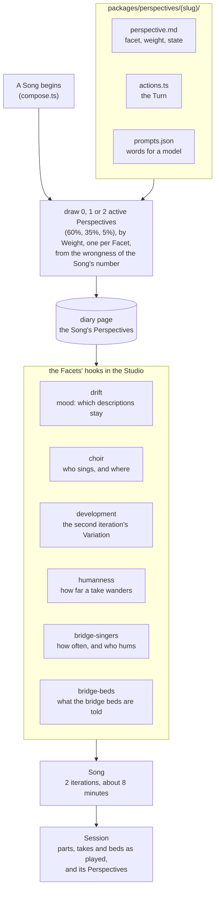

# Perspectives

A Song lasted 3–6 iterations, decided by the wrongness of its Mood: 9 to 28 minutes, 16 on average. Within a quadrillion years that is nothing, but for a contemporary human it is a long time to stay on a website, or even to listen to one piece of music.

So a Song is locked to **two iterations**: about 8 minutes at 72 bpm, from about 5.5 at the fastest tempos to about 9.5 at the slowest. That is long, but a reasonable default for a "progressive music" song. A Song change is an interesting but smallish change (the Mood drifts, a new choir is gathered, the verse tune takes a step), so the song still doesn't progress too fast, even though it now changes twice as often.

The wrongness that used to decide a Song's length is applied elsewhere instead, as **Perspectives**.

## Why Perspectives are code

Nobody prompts the Studio while it works: the robot is not there, and the Mind cannot orchestrate work this complex. So every Perspective is written down whole, ahead of time, as a record and the code that applies it. The Studio only chooses Perspectives and runs them.

## Terms

- **Perspective:** one way a Song is heard differently from the usual. A single Perspective defines its own Facet, Turn and Weight. It holds for the whole Song: both of its iterations.
- **Facet:** the part of the Studio's work a Perspective changes. A Facet is a fixed identifier, not an instruction to the Mind: it names one hook, a specific place in the Studio's code where Perspectives for that Facet are applied. The code decides what a Facet can reasonably let a Perspective change.
- **Turn:** how a Perspective changes its Facet away from the default. A Turn is code (the Perspective's `actions.ts`), and may also need words for a model, kept beside it (`prompts.json`), for example what a bridge's bed is told. A Turn may have **variants**, chosen by the wrongness of the Song, such as which percussion the bridges are played on.
- **Weight:** how likely the Perspective is to be chosen, from 1 to 10. The more drastic it is, the less weight it has.
- **Wrongness:** as before, not random. The same Song always gets the same Perspectives and the same variants, so it can be made again from the diary.

## Moderation

- How many Perspectives a Song gets is drawn for it, from a wrongness of its own (`perspectives:count:<song>`): none six Songs in ten, one in about a third, two in one Song of twenty (`perspectiveOdds`). A Song is mostly heard plainly; a way of hearing that comes every time is only the usual way. (Until 2026-11-13 it was a fixed `PERSPECTIVE_COUNT` of 2, and almost every Song was heard differently.)
- A Song never gets two Perspectives on the same Facet, so Perspectives never fight over one piece of work.
- Perspectives are drawn by Weight, without replacement, so drastic ones are rare.
- Only Perspectives in state `active` are drawn. A new one stays `draft` until it has been heard in a rehearsal.
- Every Turn is moderate by itself, and makes sense next to any other Perspective. For example, the choir humming a bridge while a lone singer sings the Song is just the lone singer humming.

There is no separate strength setting: how far a Perspective goes is its Turn, and how often it is heard is its Weight.

## Perspectives as records

Each Perspective is an arkku record of a new kind, `perspective`, in a folder of its own beside the code that applies it:

```
packages/perspectives/
  bridge-beds-dramatic-percussion/
    perspective.md   the record: facet, weight, state; what it is, in prose
    actions.ts       the Turn: a function typed for its Facet's hook
    prompts.json     the words a model is given, if the Turn needs any
```

- **The `perspective` template** stores `facet` (one of the Facets below), `weight` (1–10) and `state` (`draft`, `active` or `retired`). Its `getFilename` is `packages/perspectives/<slug>/perspective.md`, and its validation checks that `actions.ts` is there.
- **Under `packages/`**, the actions are inside the Bun workspaces, so `bun run lint` and the tests cover them like the rest of the song.
- **`actions.ts`** exports a Turn typed for its Facet: a Perspective can only touch what its Facet's hook offers, and the typecheck enforces it. A Turn is given a wrongness of its own, named by the Song and the Perspective, and never uses `Math.random`.

## The Facets

These are the Facets that have a hook in the code today, and the Turns each can reasonably take. Each line number is where the hook goes, as of `5f885fc`.

| Facet | Hook | What its Turns can change |
|---|---|---|
| `development` | `studio/lib/compose.ts:136`, where the iteration's Variation is chosen; `melody/lib/variation.ts:92` makes the Variations | How far the second iteration's Variation moves: how many verse phrases are ornamented (now one), and how many steps each takes. The chorus stays the anchor. |
| `choir` | `studio/lib/compose.ts:125`, where a Song's choir is gathered; `studio/lib/perform.ts:148`, where it is decided who sings a line | How many sing (1 to 4: the lead, then harmonies a third, a fifth and an octave below), and whether the harmonies sing the verses as well as the chorus. |
| `humanness` | `vocals/lib/humanize.ts:22-26` and `:73`, the limits of a take's wrongness; called from `studio/lib/perform.ts:100` and `:161` | How far a take wanders: pitch drift and wobble, how much a note leans into the next, and the vibrato, all scaled together. |
| `harmony` | `melody/lib/harmony.ts`, the harmonizer, called from `studio/lib/perform.ts` wherever a voice sings beside the lead; `studio/lib/compose.ts`, where a voice above the lead is gathered as a woman or a child | Whether the choir is voiced by the rules of part-writing (the default, traditional: below and close) or parallel, a fixed step from the lead as the song first sang; which side of the lead the voices sing on; how far the first voice above stands; how widely the voices below spread. Every voice stays within its body's range (`melody/lib/reach.ts`). |
| `bridge-singers` | `studio/lib/perform.ts:47`, how often a bridge is hummed; `:87`, who hums it; `:106`, whether this bridge is heard | How many of a Song's bridges are hummed aloud (now half), and whether the lead hums alone or the choir hums with it in harmony. |
| `bridge-beds` | `music/lib/underlay.ts:86`, where a section's bed is given its words; `music/accompany.py:114-118`, where the model hears the guide's melody | What the bridges' beds are told, beside or instead of the Mood's band, and whether the model follows the guide's melody at all. |
| `bridge-voice` | `studio/lib/perform.ts`, where a bridge is hummed | What a hummed bridge sings: an "ooh" a note, or scat syllables. The guide the Music grows from is always hummed. |
| `intervals` | `studio/lib/compose.ts`, where an iteration's tune is chosen; `melody/index.ts` `setBridge` | How far the verses and the bridges leap, in whole tones, within the lead's range. The chorus never leaps. |
| `drift` | `studio/lib/compose.ts:119` calls `mood/index.ts:56`, where it is decided which descriptions of the Mood stay | How many of the Mood's descriptions let go when this Song begins (now one). |

### Choosing them

Perspectives are chosen when a Song begins, in `studio/lib/compose.ts` before the Mood drifts (line 119), because `drift` changes how the Song's own weather is formed. They are drawn from the wrongness of the Song's number. Like the choir and the tune, they are written into the diary page (line 146), so the second iteration and a Studio that wakes again both find them. They go to `perform`, `underlay` and `variations` with the iteration.

The Song length is fixed in the same place: `lastsFor` (`studio/lib/compose.ts:56`) no longer drifts, and `ITERATION_COUNT` is 2.

## The first Perspectives

| Perspective | Facet | Turn | Weight |
|---|---|---|---|
| `development-wider` | `development` | The second iteration's Variation ornaments two or three verse phrases instead of one. | 6 |
| `development-deeper` | `development` | Each ornament takes two steps instead of one. | 4 |
| `choir-lone` | `choir` | One singer, no choir. | 4 |
| `choir-full` | `choir` | Four singers: the octave below joins. | 5 |
| `choir-in-the-verses` | `choir` | The harmonies sing the verses too, not only the chorus. | 3 |
| `humanness-glassy` | `humanness` | Takes wander about a third as far as usual: tight and machine-like. | 5 |
| `humanness-loose` | `humanness` | Takes wander nearly twice as far: loose and a little drunk. | 4 |
| `bridge-singers-often` | `bridge-singers` | Most bridges are hummed aloud. | 6 |
| `bridge-singers-rarely` | `bridge-singers` | Few bridges are hummed; the Music carries them alone. | 6 |
| `bridge-singers-choir` | `bridge-singers` | The choir hums the heard bridges with the lead, in harmony. | 4 |
| `bridge-beds-dramatic-percussion` | `bridge-beds` | The bridges' beds are only percussion, one kind per Song, from `prompts.json`: "war drums", "spanish clapping", "church bells" and the like, at the Song's tempo, following the guide hum for their rhythm. | 3 |
| `bridge-beds-atonal` | `bridge-beds` | The bridges' guides are hummed atonal, each note the next pitch of a twelve-tone row drawn for the Song, to the same rhythm; the beds follow them with the Mood's own band. | 2 |
| `bridge-scat` | `bridge-voice` | A heard bridge is scatted: doo, wop, bah, dap, a syllable a note, from one set per Song in `prompts.json`, never twice in a row. | 3 |
| `harmony-parallel` | `harmony` | The choir sings parallel, the lead's degree and a fixed step, every note, exactly as before the harmonizer. | 3 |
| `choir-soprano` | `harmony` | The voices turn about, the first above: a woman or a child about an octave over the lead, within her range, and the next below. | 3 |
| `drastic-intervals` | `intervals` | The verses and bridges leap between a least of 3 to 5 and a most of 5 to 12 whole tones, drawn per Song, within the lead's range. | 1 |
| `drift-big-turn` | `drift` | Every description of the Mood lets go when this Song begins, not only the oldest. | 2 |

The Music only ever grows from the guide hum: told in words alone, the old model plays anything, at any tempo, unrelated to the Song. So a Perspective turns what the guide hums or what the bed is told, and never takes the hum away. (`accompany.py` still has its `--no-melody` flag, for a stretch too short to hear, and no Perspective uses it.)

## Left out of the first set

These ideas came up, but would take more than one hook, so they wait:

- **Form**, the arrangement of an iteration (an instrumental intro or outro, a doubled chorus, a long bridge, a verse without the Music). `arrange` (`song/index.ts:214`) is shared by `perform`, the Session, the guides and the typing, and a different form changes the Song's length and every section's timing.
- **A key change** for the second iteration, under `development`. The shelf (`music/lib/shelf.ts`) plays beds again within a Song, so a transposed iteration would be sung over beds in the old key. Every bed of the second iteration would have to be grown anew.

Both can come later as Facets of their own, once the first set has been heard.

## In the Session

The Session says which Perspectives its Song was heard from: each one's slug, Facet and Turn, and the variant chosen, for example `bridge-beds-dramatic-percussion: war drums`. A Receiver can show them in the knob panel, beside the weather, the key and the choir, and anyone looking back can see them. Everything a Perspective changes is already in the Session as it is played (the parts, the takes and the beds), so a Receiver does not need to understand a Perspective to play it.


